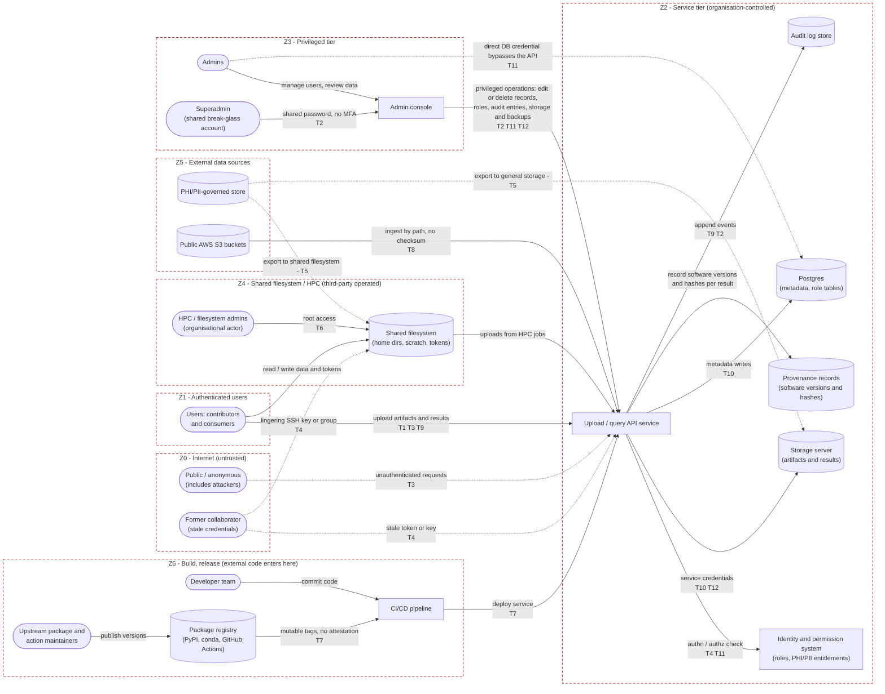
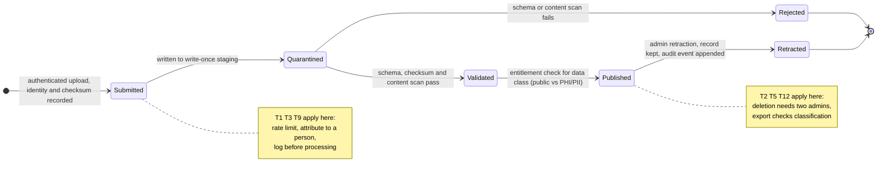
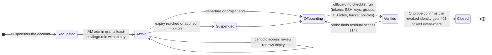

# Threat model: research data management across mixed-trust sources

| | |
|---|---|
| Status | Draft v0.1 (2026-10-19). Living document: revisit whenever a user story moves data, credentials, or control across a trust boundary. |
| Origin | Threat-modeling workshop, Group 2 (Cody Baker, Bob Caddy, Conner Brynteson, Juliette Raubolt, Ryan Speitel), plus the facilitator notes. |
| Scope | The general situation the group chose: a research platform that manages data arriving from public AWS S3 buckets, a shared (HPC) filesystem, PHI/PII-governed stores, and Postgres databases, with artifacts and results moving from user systems to a storage server through an API-controlled service. Appendix A maps the model onto this repository. |

## 1. Why and how

- **Teams without a shared model of the threat surface cannot act systematically.** Attacks on the education sector were reported in the workshop to have surged by 63%. The point of this document is to turn abstract security worry into a shared model that an RSE team can argue about, assign, and test.
- **Method:** model the system → elicit threats (STRIDE) → mitigate → validate, then iterate. "Mitigate" explicitly includes *accepting* a risk, as long as the acceptance is written down with an owner and a review date.
- **Two questions every mitigation must answer:** *Who owns it?* and *What evidence shows it works?* A mitigation without both is a wish.
- **User stories matter more, not less.** A detail that is implicit and undocumented can be exactly where control crosses a boundary. Every user story that moves data, code, credentials, or control gets a state-based flow (Section 3) and a STRIDE pass (Section 4), and the diagrams are revised over and over as the system changes.
- **Know the system and the adversary.** Nobody can enumerate *all* attack vectors. STRIDE-per-element over a data-flow diagram gives systematic coverage of the boundaries you have drawn, and automated scanning (Section 8) covers the classes of weakness you did not think of. Neither replaces the other.

### 1.1 STRIDE cheat sheet

| Letter | Threat | Property it breaks | Question to ask at each boundary |
|---|---|---|---|
| S | Spoofing identity | Authentication | Can someone pretend to be another user, service, or data source here? |
| T | Tampering with data | Integrity | Can data, code, or configuration be altered in transit or at rest here? |
| R | Repudiation | Non-repudiation / accountability | Could someone deny having submitted a job, uploaded data, or deleted a record? |
| I | Information disclosure | Confidentiality | Can data or credentials leak across this boundary? |
| D | Denial of service | Availability | Can this component be exhausted, flooded, or taken offline? |
| E | Elevation of privilege | Authorization | Can an actor gain rights beyond their tier here? |

Legend used throughout: **T1 to T12** are threat IDs from the register in Section 4. **Z0 to Z6** are trust zones from the system map in Section 2.

## 2. System map (Activity 1)

### 2.1 Assets (what we are protecting)

| Asset | Classification | Why it matters |
|---|---|---|
| Raw and derived research data (public, internal, PHI/PII) | Varies per dataset; PHI/PII is regulated | Integrity drives scientific conclusions; confidentiality drives legal and ethical obligations |
| Metadata and role tables (Postgres) | Internal | Authorization decisions are made from these rows |
| Credentials: superadmin password, admin accounts, API tokens, AWS keys, DB passwords, SSH keys | Secret | Each one is a shortcut past every other control |
| Audit log | Internal, must be tamper-evident | The only way to attribute actions and reconstruct incidents |
| Provenance records (software versions, hashes, inputs per result) | Internal / public | Determine which results are affected when a component turns out to be bad |
| Software artifacts and package distributions | Public | Everything downstream executes them |
| Availability of the API service | Service-level | Users cannot submit or query while it is down |

### 2.2 Actors (who contributes, maintains, deploys, uses, or depends on it)

The group's central observation: the major component is **who is allowed to access which levels, and how much data an attacker can take at one time**. Admins may reach all data; an individual user should reach only a small subset. The tiers form a chain of separation of concerns: **superadmin → admins → developer team → user base**.

| Actor | Tier / zone | Legitimate capability | Threat potential |
|---|---|---|---|
| Public / anonymous | Z0 Internet | Read public data | Flooding, probing, credential stuffing (T3) |
| Former collaborator | Z0 (should be) | None | Retains stale tokens, keys, group memberships (T4) |
| Users (contributors and consumers) | Z1 | Upload to own projects, read entitled data | Corrupted uploads, data exfiltration within entitlement, repudiation (T1, T5, T9) |
| Developer team | Z6 | Change code, run CI, deploy | Supply-chain exposure, credential leakage (T7, T10) |
| Admins | Z3 | Manage users, review and retract data | Self-promotion via direct DB access, over-broad reads (T11) |
| Superadmin (shared break-glass account) | Z3 | Everything | Single point of total compromise (T2, T12) |
| HPC / shared-filesystem admins | Z4, *organizational* | Operate the filesystem; root | Read or alter anything stored there, including tokens (T6) |
| Upstream package and action maintainers | Z6, external | Publish versions | A compromised release runs in our pipeline (T7) |
| Automated agents (CI runners, scheduled jobs, ingest workers) | Z2 / Z6 | Act with service credentials | Amplify any credential leak (T10) |

### 2.3 External services and packages the system trusts

The group initially wrote "n/a". On reflection, the system implicitly trusts: AWS (S3 availability, bucket policies, IAM), the institutional identity provider, Postgres and its hosting, the HPC centre and its staff, package registries (PyPI, conda channels), GitHub and GitHub Actions, and the provenance framework used to record software versions. Each is a dependency and therefore a boundary.

### 2.4 Where code, data, credentials, models, artifacts, and results move

| Flow | From → To | Carries |
|---|---|---|
| F1 | User system / HPC job → Upload API → Storage server | Artifacts and results |
| F2 | Upload API → Postgres | Metadata, ownership, status |
| F3 | Upload API → Audit log | Who did what, when |
| F4 | Public S3 bucket → Ingest worker → Storage | Externally published data, trusted by path |
| F5 | PHI/PII store → (should never) → Shared filesystem or public bucket | Governed data |
| F6 | Package registry → CI → Deployed API | Third-party code |
| F7 | CI → Provenance records | Versions and hashes of what produced each result |
| F8 | Admin console → API → Postgres, Audit log, Storage (and a direct DB credential that bypasses the API) | Record edits, retractions, deletions |
| F9 | Identity provider → API | Authentication and entitlement decisions |

### 2.5 Trust boundaries (where control passes between actors or systems)

| Zone | Boundary crossed when entering | Who controls the far side |
|---|---|---|
| Z0 Internet | Any request reaching the API | Nobody we trust |
| Z1 Authenticated users | Identity provider accepts a credential | The user and the IdP |
| Z2 Service tier | API acts with service credentials on storage, DB, audit log | The platform team |
| Z3 Privileged tier | Admin or superadmin session | A few named people (and one shared account) |
| Z4 Shared filesystem / HPC | Data or tokens land on the shared filesystem | A third-party organisation with root |
| Z5 External data sources | Ingest reads from a public bucket; export leaves the PHI/PII zone | Bucket owner; compliance regime |
| Z6 Build, release, provenance | A package version or action is pulled into CI | Upstream maintainers |

## 3. Diagrams

Mark where trust changes or control crosses between components. Solid arrows are intended flows; dashed arrows are threat paths. Edge labels carry the threat IDs from Section 4.

### 3.1 Data-flow diagram with trust boundaries

### 3.2 Submission lifecycle (state-based flow for the "upload results" user story)

Each state is a place where a STRIDE question applies. Consumers only ever read from `Published`.

### 3.3 Account lifecycle (state-based flow for the "former collaborator" threat)

## 4. Threat register (Activity 2)

Template: *An actor can [action] at [component or boundary], causing [impact] because [assumption or weakness].* Threats T1 to T3 are the ones the group identified in the workshop; T4 to T12 come from walking STRIDE across every boundary in Section 2.5 and from the facilitator notes.

| ID | STRIDE | Boundary | Threat statement |
|---|---|---|---|
| T1 | Tampering | Z1 → Z2 (upload API → storage) | A contributor, or anyone holding a contributor's credential, can upload corrupted or malicious data through the upload API into the storage server, causing downstream analyses and consumers to act on wrong or hostile content, because the API accepts client-supplied content on the strength of authentication alone and stores it alongside validated data. |
| T2 | Elevation of privilege → Tampering, Repudiation | Z0 → Z3 (superadmin) | An attacker who obtains the shared superadmin password can log into the admin console and delete internal records *and* the audit entries that record the deletion, causing undetectable loss of data and of accountability, because the superadmin is a single shared account without MFA and the audit log is writable by the very role it is meant to watch. |
| T3 | Denial of service | Z0 → Z2 (API) | Anyone on the Internet can flood the main API service, or trigger expensive validation and upload work, causing ingest and query to become unavailable to legitimate users, because unauthenticated endpoints are not rate-limited and upload processing shares resources with the request path. |
| T4 | Spoofing (stale identity) | Z0 → Z1, Z0 → Z4 | A former collaborator can keep authenticating as a trusted user through a surviving API token, SSH key on the shared filesystem, or group membership, causing unauthorized reads or writes attributed to a "trusted" identity, because offboarding is a manual checklist that nobody verifies. |
| T5 | Information disclosure | Z5 → Z4 / Z2 (PHI/PII zone exit) | A user or job can copy PHI/PII-governed data out of the governed zone into the shared filesystem or a public S3 bucket, causing a regulatory breach and loss of participant confidentiality, because access rules are attached to storage locations rather than travelling with the data's classification. |
| T6 | Information disclosure, Tampering (organisational) | Z4 (HPC admins) | An HPC or shared-filesystem administrator, or anyone who compromises their root account, can read or alter data, credentials, and results on the shared filesystem, causing silent corruption or disclosure, because the organisation trusts the HPC centre implicitly and users keep tokens and keys in their home directories. |
| T7 | Tampering (supply chain) | Z6 → Z2 (registry → CI → deploy) | An attacker who compromises an upstream package, a CI action, or a maintainer account can execute code inside the build and deploy pipeline and therefore inside the API service, causing arbitrary tampering with code, data, and credentials, because dependencies are resolved by mutable version tags without signature or attestation verification. |
| T8 | Tampering, Spoofing (untrusted source) | Z5 → Z2 (public bucket → ingest) | An actor can replace or poison objects in a public S3 bucket, through a misconfigured write policy or by re-registering a deleted bucket name, causing poisoned data to be ingested as trusted, because the ingest job trusts bucket content by path with no checksum or publisher verification. |
| T9 | Repudiation | Z1 → Z2 (API → audit log) | A user can deny having submitted a job or dataset, or having deleted a record, causing disputes that cannot be settled and incident response that cannot establish facts, because actions are logged at the service-account level and audit entries are mutable. |
| T10 | Information disclosure (credentials) | Z6 / Z4 → Z2 | An actor with read access to a code repository, CI logs, or a shared configuration directory can obtain service credentials (AWS keys, DB password, API tokens), causing full impersonation of the service at the storage and database boundary, because secrets are stored alongside code and printed in logs. |
| T11 | Elevation of privilege | Z3 → Z2 (admin → Postgres) | An admin, or an attacker holding an admin's DB credential, can edit role tables directly in Postgres, causing self-promotion to superadmin with no audit trail, because authorization is enforced only in the application layer and the DB credential bypasses it. |
| T12 | Denial of service, Tampering (destruction) | Z3 → Z2 (storage and backups) | An actor with storage credentials can delete or encrypt the storage server contents and its backups, causing permanent loss of results, because backups are reachable with the same credentials and have no retention lock. |

## 5. Hardening (Activity 3)

For each threat: can we prevent it, detect it, limit its blast radius, recover from it; what specifically we would do; who owns it; and what evidence shows the mitigation works. Owners are roles, to be mapped to named people by the team.

### T1 Corrupted or malicious upload

| Question | Answer |
|---|---|
| Prevent? | Partially. Schema and checksum validation at the API before acceptance; file-type sniffing, size limits, and malware scanning for binaries; a write-once staging area separate from published data. |
| Detect? | Yes. Validation failures logged per identity; alerts on unusual upload volume or repeated rejections; a periodic job re-validates stored objects against their recorded checksums. |
| Limit blast radius? | Yes. The quarantine → validated → published lifecycle (Section 3.2); per-project namespaces; consumers read only `Published`; object versioning so a bad upload never overwrites the previous version. |
| Recover? | Yes. Roll back to the previous object version; retraction flow; provenance links identify every analysis that consumed the bad object. |
| Specific mitigation | Implement the submission lifecycle as a gate the API enforces, not a convention; enable versioning on the storage bucket. |
| Owner | Service owner (validation gate); Data steward (acceptance criteria per data type). |
| Evidence | A corpus of known-bad files is rejected in CI on every release; monthly count of quarantined vs published objects; the re-validation job reports zero checksum mismatches. |

### T2 Superadmin hijack with audit-log deletion

| Question | Answer |
|---|---|
| Prevent? | Mostly. Rotate the shared superadmin password now; MFA on every admin account; replace the shared account with named admin accounts plus a sealed break-glass credential kept in a vault whose use raises an alert; admin console reachable only from an allow-listed network. |
| Detect? | Yes. Every superadmin login notifies a second person; the audit log is shipped in real time to an append-only store (WORM bucket or separate account) that no application role can write to; alerts on bulk deletes. |
| Limit blast radius? | Yes. Deletes are soft-deletes with a retention window; destructive actions require two-person approval; there is simply no code path by which the admin console deletes audit entries. |
| Recover? | Yes. Restore records from immutable backups; the off-site audit copy reconstructs what happened. |
| Specific mitigation | Named accounts + MFA + break-glass vault; audit log forwarding to WORM storage; two-person rule on deletes. |
| Owner | IAM admin (accounts, MFA, break-glass); Service owner (audit pipeline, soft delete). |
| Evidence | Quarterly test: a superadmin attempts to delete an audit entry, the attempt fails and an alert fires; break-glass use count is zero outside drills; MFA enrolment report shows 100% of privileged accounts. |

### T3 Denial of service against the API

| Question | Answer |
|---|---|
| Prevent? | Partially. Rate limiting per IP and per token; authentication required for expensive endpoints; upload size limits; a CDN or WAF in front of the API; validation runs on an asynchronous queue so it cannot block request threads. |
| Detect? | Yes. Latency and error-rate alerts; request-rate dashboards; synthetic uptime probes from outside. |
| Limit blast radius? | Yes. Upload workers separated from the query path; autoscaling with a budget cap; per-tenant quotas so one abusive user cannot starve the rest. |
| Recover? | Yes. Runbook: block offending ranges, scale out, replay the queue. No data is lost, only availability. |
| Specific mitigation | Rate limiter and WAF; queue-based upload processing; quotas. Accept that volumetric attacks beyond the provider's protection are out of scope. |
| Owner | Service owner / platform team. |
| Evidence | A load test in staging shows the rate limiter trips while the query path stays within its latency objective; the alert fires during a game-day exercise; monthly uptime report. |

### T4 Former collaborator retains access

| Question | Answer |
|---|---|
| Prevent? | Yes. Every grant tied to an identity in the IdP with an expiry and a sponsor; group-based permissions so removal from one group removes everything; short-lived tokens instead of permanent API keys; SSH certificates with expiry instead of static keys. |
| Detect? | Yes. Weekly reconciliation of IdP membership against actual grants (DB roles, bucket policies, `authorized_keys`, repository collaborators); alert on any login by a deactivated identity. |
| Limit blast radius? | Yes. Least privilege means a stale account cannot reach PHI or admin functions; per-project namespaces. |
| Recover? | Yes. Revoke, rotate any shared secret the person could have seen, review the audit log for activity since departure. |
| Specific mitigation | "Offboarding checklist as code": a CI job that takes a revoked identity and probes every surface (API, DB, filesystem, S3, repositories), expecting 401 or 403 from each. Run it on every offboarding and quarterly against a sample of past leavers. (Section 3.3.) |
| Owner | IAM admin (execution); PI or sponsor (triggering departure). |
| Evidence | The probe passes for every offboarded identity and its output is retained; the reconciliation report shows zero orphaned grants; mean time from departure to full revocation is tracked. |

### T5 PHI/PII leaves the governed zone

| Question | Answer |
|---|---|
| Prevent? | Partially. A classification label attached to each dataset at ingest; the API refuses to copy labelled data to a destination without matching entitlement; governed data lives in separate buckets and filesystems where public access is blocked at the account level; exports pass through de-identification. |
| Detect? | Yes. Scheduled DLP scans of public buckets and the shared filesystem for identifiers; alerts on bucket-policy changes; access logs on governed stores reviewed by the data steward. |
| Limit blast radius? | Yes. Minimum-necessary access; encryption with keys that never leave the governed zone; export only derived or aggregate data. |
| Recover? | Partially. Remove from the public location and report per IRB and HIPAA obligations; a disclosure cannot be undone, so the breach runbook must already exist. |
| Specific mitigation | Classification labels enforced by the API; account-level Block Public Access; DLP scanning; breach runbook. |
| Owner | Data steward / compliance officer (policy, runbook); Service owner (technical enforcement). |
| Evidence | DLP scan returns zero hits; a test attempt to publish a labelled test dataset to a public bucket is refused and logged; the cloud account shows Block Public Access enabled. |

### T6 HPC or shared-filesystem administrators (organisational threat)

| Question | Answer |
|---|---|
| Prevent? | Partially. Encrypt sensitive data at rest with keys held outside the HPC centre; never store long-lived tokens on the shared filesystem (short-lived tokens, hardware keys, or a vault agent); do not place PHI/PII on HPC at all unless the centre is contractually within the governed zone. |
| Detect? | Partially. Integrity checksums recorded at ingest and compared on read; API-side audit of unexpected uploads from HPC identities. |
| Limit blast radius? | Yes. Data classification decides what may live on HPC; HPC upload tokens are scoped to a single project. |
| Recover? | Yes. Re-fetch from authoritative storage; rotate tokens. |
| Specific mitigation | Accept the residual risk (the HPC centre is a contracted partner with its own controls) and record the acceptance in Section 6; compensate with encryption and token hygiene. |
| Owner | HPC liaison (relationship, agreement); Data steward (classification decision). |
| Evidence | A secret-pattern scan of home directories returns zero findings; the data inventory shows no governed data on HPC; a written statement from the HPC centre on admin-access logging is on file and reviewed yearly. |

### T7 Supply-chain compromise of a package or CI action

| Question | Answer |
|---|---|
| Prevent? | Mostly. Pin dependencies by hash (lockfiles, `pip --require-hashes`, `conda-lock`); pin GitHub Actions to full commit SHAs; verify signatures and attestations (Sigstore, PyPI attestations, SLSA provenance) in CI; least-privilege CI tokens and OIDC instead of long-lived cloud keys; egress allow-list for runners. |
| Detect? | Yes. Dependabot, OSV-Scanner, or `pip-audit`; OpenSSF Scorecard; alerts on maintainer changes for critical upstreams; CI egress monitoring. |
| Limit blast radius? | Yes. Build in isolated runners with minimal secrets; separate build and deploy credentials; provenance records (Section 9) identify every result produced with the bad version. |
| Recover? | Yes. Rebuild from the last known-good lockfile; rotate every secret the pipeline could reach; use provenance to retract or re-run affected results. |
| Specific mitigation | Hash-pinned lockfiles, SHA-pinned actions, attestation verification step, OIDC for cloud access. Also *publish* our own distributions with signatures and attestations so downstream users can verify us. |
| Owner | Dev lead / release manager. |
| Evidence | CI fails when a dependency hash or action SHA changes without a lockfile update (tested deliberately); Scorecard's pinned-dependencies check is green; the attestation verification step appears in every deploy log. |

### T8 Poisoned public S3 bucket as a data source

| Question | Answer |
|---|---|
| Prevent? | Partially. Ingest only from an allow-list of bucket names and owner account IDs; verify object checksums against a manifest the data owner publishes over a separate channel; reference objects by version ID and hash, not path alone. For buckets we own: Block Public Access except explicit read, object versioning and object lock, bucket owner enforced, and never release a bucket name. |
| Detect? | Yes. Checksum mismatch alerts; AWS Config rules flag any bucket that allows public write. |
| Limit blast radius? | Yes. Ingested public data enters the same quarantine lifecycle as uploads (T1). |
| Recover? | Yes. Versioning allows rollback; re-ingest from the manifest. |
| Specific mitigation | Source allow-list plus manifest checksums in the ingest worker. |
| Owner | Service owner (ingest); Data steward (source allow-list). |
| Evidence | Ingest refuses an object whose checksum differs from the manifest (tested); AWS Config shows zero public-write buckets. |

### T9 Repudiation of a submission or deletion

| Question | Answer |
|---|---|
| Prevent? | Yes. Every API action carries an authenticated *individual* identity (no shared accounts); each audit entry records who, what, when, and the content hash; the log is append-only with hash chaining or is shipped to WORM storage; optionally, clients sign submissions. |
| Detect? | Yes. Breaks in the hash chain; mismatches between storage objects and audit entries. |
| Limit blast radius? | Yes. Independent corroborating logs (storage access logs, API gateway logs) survive even if one entry is disputed. |
| Recover? | Partially. Reconstruct from the redundant logs. |
| Specific mitigation | Individual identities everywhere; tamper-evident audit log. |
| Owner | Service owner. |
| Evidence | A monthly job matches a random sample of storage objects to their audit entries; the log-integrity verification job passes. |

### T10 Credential leakage

| Question | Answer |
|---|---|
| Prevent? | Yes. Secrets live in a secret manager, never in code or config files; workload identity (OIDC) instead of static keys where possible; pre-commit and CI secret scanning; log redaction; separate credentials per environment. |
| Detect? | Yes. Repository secret scanning with push protection; `gitleaks` in CI; cloud alerts on key use from unexpected locations; periodic scans of the shared filesystem. |
| Limit blast radius? | Yes. Short-lived, least-privilege credentials scoped to one bucket or one database. |
| Recover? | Yes. Rotation runbook; audit what the key accessed while exposed. |
| Specific mitigation | Secret manager plus OIDC; scanning in pre-commit and CI. |
| Owner | Dev lead (code and CI); IAM admin (rotation). |
| Evidence | Scanners report zero findings; a maximum-credential-age report; a secret committed to a test branch is blocked by push protection (tested). |

### T11 Admin self-promotion through direct database access

| Question | Answer |
|---|---|
| Prevent? | Yes. No human holds a production write credential; role changes go through the application with audit and two-person approval; humans get read-only replica access; database audit logging (`pgAudit`) on role tables; network policy restricts DB connections to the application hosts. |
| Detect? | Yes. Audit of DDL and DML on role tables; alert on any connection not from the application; nightly diff of the role table against the last reviewed snapshot. |
| Limit blast radius? | Yes. Superadmin privileges still require MFA at the console; break-glass alerts. |
| Recover? | Yes. Restore roles from the last reviewed snapshot; audit log identifies the change. |
| Specific mitigation | Remove human write credentials; `pgAudit`; network restriction. |
| Owner | Service owner / DBA. |
| Evidence | A direct connection with an admin credential from a laptop is refused and logged (tested); the role-table alert fires in a drill. |

### T12 Destructive actions on storage and backups

| Question | Answer |
|---|---|
| Prevent? | Partially. Backups live in a separate account the production credential cannot delete from; object versioning and object lock with a retention period; MFA-delete; no single credential has both production write and backup delete. |
| Detect? | Yes. Alerts on mass delete or encrypt patterns from storage access logs; backup-job health checks. |
| Limit blast radius? | Yes. Versioning makes delete a soft operation for the retention window; per-project buckets. |
| Recover? | Yes. Documented recovery point and recovery time objectives; restore drills. |
| Specific mitigation | Separate backup account, object lock, restore drills. |
| Owner | Service owner / platform team. |
| Evidence | A quarterly restore drill with timed recovery; a test showing the production credential receives AccessDenied on the backup account. |

## 6. Accepted risks

Accepting a risk is a mitigation decision, so it gets the same owner and evidence as any other.

| Risk | Decision | Compensating controls | Owner | Review |
|---|---|---|---|---|
| HPC administrators can read anything on the shared filesystem (T6 residual) | Accept | No governed data on HPC; encryption with external keys; no long-lived tokens on the filesystem; written statement from the centre | HPC liaison | Yearly |
| Volumetric DoS beyond the cloud provider's protection (T3 residual) | Accept | Provider DDoS protection; runbook; no data loss | Service owner | Yearly |
| Public data in public buckets is read by anyone | Accept (by design) | Classification label guarantees only public-class data lands there (T5) | Data steward | On any classification change |

## 7. Organisational threats

The group asked whether organisational threats were considered. They were not in the first pass, so they are listed here explicitly:

- **HPC and shared-filesystem administrators** (T6): root on the system where users keep data and tokens.
- **Cloud provider staff and institutional IT**: operate the identity provider and the accounts; a compromised SSO administrator is a compromised platform. Mitigation is mostly contractual plus MFA and anomaly alerts.
- **Insiders**: a disgruntled admin is T2 and T11 without needing to steal anything. Two-person rules and tamper-evident logs are the controls.
- **Social engineering of admins**: password-reset and "urgent access" requests. Verified out-of-band approval for any privilege change.
- **Governance and funding boundaries**: data-use agreements decide what may be shared; a collaborator institution's departure is an offboarding event for every account it sponsored (T4 at organisation scale).

## 8. Automated scanning and tooling

The workshop asked whether there is a central scanning framework beyond simple code quality. There is no single tool, but the following classes together cover most of what a threat model will not predict:

| Class | What it finds | Example tools |
|---|---|---|
| Threat-model tooling | Structured elicitation with suggested mitigations per threat | Microsoft Threat Modeling Tool (Windows desktop; check its release page for currency before adopting), OWASP Threat Dragon (open source), `pytm` (threat model as code; the model lives in git beside the user stories and diffs with them) |
| Static analysis (SAST) | Injection, unsafe deserialisation, path traversal in our own code | CodeQL, Semgrep |
| Dependency scanning (SCA) | Known-vulnerable package versions | Dependabot, OSV-Scanner, `pip-audit` |
| Secret scanning | Credentials committed to repositories or logs | GitHub secret scanning with push protection, `gitleaks` |
| Cloud and infrastructure posture | Public buckets, over-broad IAM, unencrypted stores | AWS Config, Prowler, Checkov |
| Container and image scanning | Vulnerable base images | Trivy |
| Dynamic testing (DAST) | Live API issues such as missing auth or rate limits | OWASP ZAP |
| Repository hygiene | Unpinned actions, missing branch protection, no SECURITY.md | OpenSSF Scorecard |

Scanning is a detection control: it must feed an owner and a queue, or it is noise.

## 9. Supply chain, attestations, and provenance

**Attestations and signatures for package distributions.** Everything we publish should be verifiable by whoever consumes it: Trusted Publishing from CI (no long-lived registry tokens), Sigstore signatures, and build-provenance attestations (SLSA or GitHub artifact attestations) attached to each release. Everything we consume should be verified the same way in CI (T7).

**How security interacts with provenance records (for example STAMPED).** Provenance records which software versions produced which results. The question raised in the workshop was: what if a recorded version is itself malicious?

1. Provenance does not *prevent* a bad version from being used; it makes the blast radius **queryable**. "Which results were produced with package X at version Y?" becomes a lookup, and those results can be retracted or re-run. Without provenance the honest answer is "we do not know".
2. For that query to be trustworthy, provenance must record **immutable identifiers** (digests, resolved commit SHAs, lockfile hashes), not just version strings or tags, because tags and some channels can be re-pointed after the fact.
3. Provenance records are themselves an asset: an attacker who tampers with them hides their tracks. They belong in the append-only audit path (T9) and should be signed by the pipeline that produced them.
4. Record the verification result alongside the version ("attestation verified" or "unverified") so that an unverified build is visible in the provenance of every result it produced.

In this repository the `environments/` records already serve as provenance of package versions per benchmark run; see Appendix A.

## 10. Should this be documented publicly?

Yes for the model, no for live weaknesses.

- **Public:** architecture, trust boundaries, the control inventory, the threat register, and mitigations that are in place. This is normal for open research software, helps contributors understand expectations, and lets outside reviewers challenge the model. "Security through obscurity" is not a control.
- **Private until fixed:** any specific, currently exploitable weakness with enough detail to give an attacker a shortcut today; hostnames, account names, and system names tied to a known gap; incident details. Track these in a private issue or security advisory with a target date, and move them into the public document once mitigated. Publish a `SECURITY.md` with a disclosure channel so that outsiders can report rather than exploit.
- **Rule of thumb:** if a line would help an attacker *today*, it goes in the private tracker and the public document says "open, tracked privately".

This document follows that rule: it describes a generic scenario and names no hosts or accounts.

## 11. Immediate action items from the workshop

| # | Action | Threats | Owner | When |
|---|---|---|---|---|
| 1 | Rotate the shared superadmin password; enable MFA; move to named admin accounts with a vaulted break-glass credential | T2 | IAM admin | This week |
| 2 | Pin CI actions to commit SHAs and dependencies to hashes; add an attestation verification step | T7 | Dev lead | Next release |
| 3 | Write the offboarding probe and run it against every past leaver | T4 | IAM admin | This month |
| 4 | Ship the audit log to an append-only store the application cannot write to | T2, T9 | Service owner | This quarter |
| 5 | Add a data-classification label at ingest and enforce it on export | T5 | Data steward, Service owner | This quarter |
| 6 | Add "state-based flow + STRIDE checklist" to the user-story template; revisit this document at each review | All | Dev lead | Now |
| 7 | Decide the public/private split for findings and add a `SECURITY.md` | n/a | Dev lead | Now |

## Appendix A: mapping the model onto this repository

This repository is a small instance of the general situation: a database of anonymous benchmark results that other people's tooling consumes.

| Model element | In this repository | Threat | Assessment |
|---|---|---|---|
| Upload API → storage (F1) | Results arrive as JSON files committed to `results/`, `machines/`, and `environments/` by benchmark runners via git push or pull request. The trust boundary is GitHub write access to the repository. | T1 | No schema validation runs on incoming files, so a malformed record reaches the bundle. Low impact (timing data), but a validation workflow on pull requests would close it cheaply. |
| Build and release (F6, F7) | A nightly workflow with `contents: write` runs a third-party bundling action pinned to a mutable `@v1` tag and force-pushes the `dist` branch. | T7 | Whoever controls that tag controls a token with write access to this repository. Pin the action to a full commit SHA and let Dependabot propose bumps. |
| Published artifact | Consumers download `bundle.json.gz` from the `dist` branch with no checksum or attestation. | T8 | Publish a digest or a build-provenance attestation alongside the bundle so consumers can verify it. |
| External data source (F4) | Benchmarks read public objects from DANDI's S3 buckets and API. | T8 | Integrity of the inputs affects only timing numbers; accept. |
| Provenance (Section 9) | Each result links a `machine_hash` and an `environment_hash`; the environment record lists every package and version in the run. | T7 | This is working provenance: a compromised package version can be traced to every affected result with one search. Versions are strings, not digests, which is the gap item 2 of Section 9 describes. |
| Data classification (T5) | Machine records contain a pseudonymous name, hardware specifications, and system mount points; a scan found no usernames, hostnames, or home-directory paths. | T5 | Public classification is appropriate. Keep a check in the validation workflow so a future field cannot reintroduce identifying paths. |
